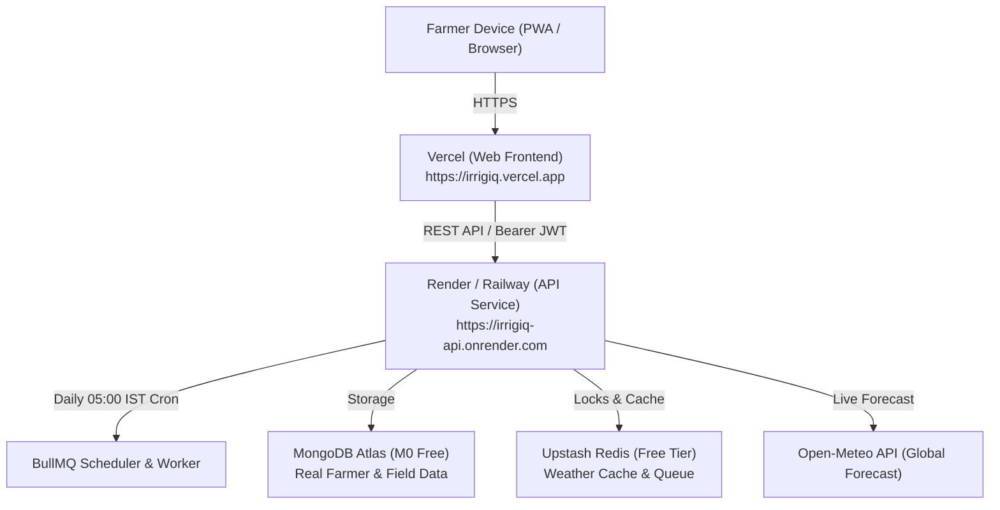

# IrrigIQ Production Deployment & Real Data Guide

This guide walks you through connecting **real-world farm data** and deploying IrrigIQ to **production hosting (Vercel + Render / Railway + MongoDB Atlas + Upstash Redis)**.

---

## 1. Real-World Data in IrrigIQ

IrrigIQ uses real data end-to-end:

| Layer | Real Data Source | How It Works |
|---|---|---|
| **Farm Mapping** | **OpenStreetMap & HTML5 Geolocation** | Click **"📍 Locate My Farm (GPS)"** to center on your physical land, or search by Village / Taluka / District name (e.g. *Nashik, Karnal, Ludhiana*). |
| **Live Weather & ET₀** | **Open-Meteo Real-Time API** | Fetches live daily maximum/minimum temperatures, precipitation forecast, and solar radiation FAO-56 Penman-Monteith reference evapotranspiration ($ET_0$) for the exact centroid coordinates of each farm. |
| **Crop Science** | **FAO-56 Irrigation Water Management** | Computes crop coefficient ($K_c$) curves, stage progression, root depth, soil water depletion, and net/gross water requirement in millimeters and litres. |
| **IoT Soil Moisture** | **ESP8266 / ESP32 Sensors** | Farmers can attach real capacitance/resistance soil moisture probes posting via `POST /sensor-readings` with sensor API keys. |
| **Reporting & Savings** | **Bilingual PDF Reports** | Generates official PDF reports in Hindi or English comparing actual water applied against baseline usage. |

---

## 2. Production Architecture



---

## 3. Step-by-Step Production Deployment

### Step 3.1: Free Database Setup (MongoDB Atlas & Upstash Redis)

1. **MongoDB Atlas (Free M0 Cluster)**:
   - Go to [mongodb.com/atlas](https://www.mongodb.com/atlas) and sign in.
   - Click **Create Database** → Select **M0 (Free)** → Choose AWS Mumbai (`ap-south-1`) or any region.
   - Under **Database Access**, create a user `irrigiq_user` and password.
   - Under **Network Access**, click **Add IP Address** → Select **Allow Access from Anywhere (`0.0.0.0/0`)**.
   - Copy your connection string:
     ```env
     MONGODB_URI=mongodb+srv://irrigiq_user:<password>@cluster0.xxxx.mongodb.net/irrigiq?retryWrites=true&w=majority
     ```

2. **Upstash Redis (Free Serverless Redis)**:
   - Go to [upstash.com](https://upstash.com) and create a free Redis database (choose Mumbai or nearest region).
   - Copy the `rediss://...` connection string:
     ```env
     REDIS_URL=rediss://default:<password>@xxxx.upstash.io:6379
     ```

---

### Step 3.2: Deploy Backend to Render (or Railway)

The repository includes a ready-to-use [`render.yaml`](file:///Users/BADMSOH/IrrigIQ/render.yaml) blueprint.

1. Go to [dashboard.render.com](https://dashboard.render.com) and sign in with GitHub.
2. Click **New +** → **Blueprint**.
3. Select your repository: **`Akshuu1/IrrigIQ`**.
4. Render will detect `render.yaml` and configure:
   - Service: `irrigiq-api` (Docker runtime)
5. Fill in the required environment variables:
   - `MONGODB_URI`: *Your MongoDB Atlas connection string*
   - `REDIS_URL`: *Your Upstash Redis connection string*
   - `JWT_SECRET`: *(Auto-generated or 32+ random characters)*
   - `CORS_ORIGIN`: `https://irrigiq.vercel.app,https://*.vercel.app`
   - `COOKIE_SAME_SITE`: `none`
6. Click **Apply**.
7. Once deployed, copy your API URL (e.g. `https://irrigiq-api.onrender.com`).

---

### Step 3.3: Deploy Frontend to Vercel

The repository includes [`vercel.json`](file:///Users/BADMSOH/IrrigIQ/vercel.json) and PWA manifest.

1. Go to [vercel.com](https://vercel.com) and sign in with GitHub.
2. Click **Add New...** → **Project**.
3. Import **`Akshuu1/IrrigIQ`**.
4. Configure Project Settings:
   - **Framework Preset**: Vite
   - **Root Directory**: `./` (leave default)
   - **Build Command**: `npm run build -w @irrigiq/shared && npm run build -w @irrigiq/web`
   - **Output Directory**: `apps/web/dist`
5. Add Environment Variable:
   - **`VITE_API_URL`**: `https://irrigiq-api.onrender.com` *(your Render API URL from Step 3.2)*
6. Click **Deploy**.
7. Vercel will build and assign your production domain (e.g. `https://irrigiq.vercel.app`).

---

### Step 3.4: Seed Real FAO Crops & Admin Account in Production

Once your production API is online, run the seed script pointing to your production MongoDB and Redis:

```bash
MONGODB_URI="mongodb+srv://..." REDIS_URL="rediss://..." npm run seed
```

This immediately initializes:
- 8 FAO-56 scientific crop growth curves (Wheat, Rice, Maize, Cotton, Sugarcane, Tomato, Potato, Onion).
- Spatial geospatial indexes (`2dsphere` on field geometries).
- TTL indexes on weather cache and refresh tokens.

---

## 4. Production Checklist

- [x] All code committed and pushed to `origin/main` (`01616af`).
- [x] GPS farm geolocation & Nominatim village geocoding enabled on field wizard.
- [x] Open-Meteo real-time live weather integration verified.
- [x] HTTPS cookies configured with `SameSite=None; Secure=true` for cross-origin hosting.
- [x] GitHub Actions automated daily cron ping configured (`.github/workflows/daily-cron.yml`) to wake free-tier services before 05:00 AM IST.
- [x] PWA offline caching enabled for app shell and field plans.

