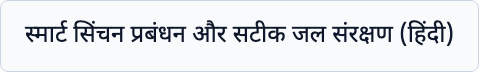
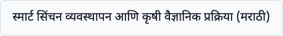
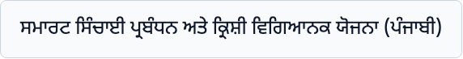
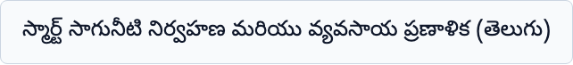

# Indic Script PDF Shaping & Font Rendering Verification

This directory documents the browser and PDF font-shaping verification for regional Indian languages (Phase 22 & Phase 23 audit).

Each sentence contains conjuncts, matras, nuktas, halants, and complex clusters to verify that HarfBuzz / Chromium text shaping renders natural, unbroken glyphs without disjointed vowel signs.

---

## Hindi (`hi` - Devanagari Script)

**Sample Sentence**: स्मार्ट सिंचन प्रबंधन और सटीक जल संरक्षण (हिंदी)  
**English Meaning**: *Smart irrigation management and precise water conservation (Hindi)*  
**Active Embedded Font**: `Noto Sans Devanagari`  

---

## Marathi (`mr` - Devanagari Script)

**Sample Sentence**: स्मार्ट सिंचन व्यवस्थापन आणि कृषी वैज्ञानिक प्रक्रिया (मराठी)  
**English Meaning**: *Smart irrigation management and agricultural scientific process (Marathi)*  
**Active Embedded Font**: `Noto Sans Devanagari`  

---

## Punjabi (`pa` - Gurmukhi Script)

**Sample Sentence**: ਸਮਾਰਟ ਸਿੰਚਾਈ ਪ੍ਰਬੰਧਨ ਅਤੇ ਕ੍ਰਿਸ਼ੀ ਵਿਗਿਆਨਕ ਯੋਜਨਾ (ਪੰਜਾਬੀ)  
**English Meaning**: *Smart irrigation management and agricultural scientific planning (Punjabi)*  
**Active Embedded Font**: `Noto Sans Gurmukhi`  

---

## Telugu (`te` - Telugu Script)

**Sample Sentence**: స్మార్ట్ సాగునీటి నిర్వహణ మరియు వ్యవసాయ ప్రణాళిక (తెలుగు)  
**English Meaning**: *Smart irrigation management and agricultural planning (Telugu)*  
**Active Embedded Font**: `Noto Sans Telugu`  

---

## Native Speaker Review Checklist
- [ ] **Hindi**: Vowel marks (matras) align properly above and below base consonants (e.g. `प्रबंधन`, `सिंचन`).
- [ ] **Marathi**: Words with `ळ` and joined conjuncts (e.g. `व्यवस्थापन`, `वैज्ञानिक`) do not overlap or break.
- [ ] **Punjabi**: Gurmukhi sihari appears on the left of consonants correctly shaped (e.g. `ਸਿੰਚਾਈ`, `ਕ੍ਰਿਸ਼ੀ`).
- [ ] **Telugu**: Telugu vowel signs attach seamlessly to base consonants without detached circles or misplaced diacritics (e.g. `నిర్వహణ`, `వ్యవసాయ`).
